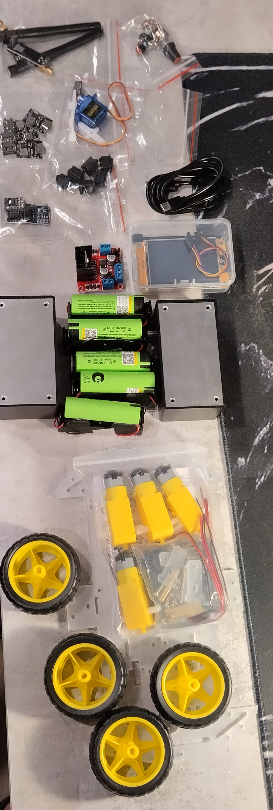

# Portfolio-AI-code-vs-My-own-code
My journey from zero to building 4 autonomous Arduino &amp; ESP32 devices: comparing AI-generated baseline code with my own optimized implementations.

WELCOME TO MY ENGINEERING PORTFOLIO!
This repository documents how I went from having zero experience in electronics and C++ programming to designing, soldering, and coding four autonomous hardware devices using **Arduino** and **ESP32**.

Core Concept & Academic Integrity

Instead of simply copying AI-generated sketches, I use Artificial Intelligence as an interactive mentor and benchmark. For each device in this portfolio, I document the entire engineering lifecycle:
1. **Hardware Assembly & Wiring:** Pinout diagrams, soldering logs, power autonomy (18650 Li-Ion), and custom 3D/enclosure layouts.
2. **AI Baseline (`01-ai-baseline/`):** The initial code generated by AI along with the exact prompts I used.
3. **My Iterative Rewrite (`02-my-own-code/`):** My own code written from scratch as I learned C++, hardware interrupts, trigonometry, and memory management.
4. **Code Comparison & Benchmarks:** Side-by-side analysis comparing AI code vs. my own code (RAM/Flash usage, sensor stability, and UI responsiveness).

Project Roadmap (4 Core Devices)

| # | Device Name | Microcontroller | Key Hardware & Math Concepts | Status |
| :--- | :--- | :--- | :--- | :--- |
| **01** | **ESP32 Touchscreen Scientific Calculator** | ESP32 + 2.8" TFT Touch | Custom UI, expression parsing, graphing functions, 18650 battery autonomy | Parts Ready / In Progress |
| **02** | **Ultrasonic Radar & Geometry Scanner** | Arduino Nano | HC-SR04, SG90 Servo, OLED 0.96", trigonometry ($S$ and $P$ area/perimeter calculation) | Parts Ready / In Progress |
| **03** | **Probability & Statistics Logger** | Arduino Nano | KY-017 tilt sensor, OLED display, empirical probability & Law of Large Numbers | Parts Ready / In Progress |
| **04** | **FPV Radio-Controlled Rover** | Arduino Uno + Nano + ESP32-CAM | NRF24L01+ 2.4GHz wireless link, KY-023 joystick, L298N motor driver, live Wi-Fi video | Parts Ready / In Progress |

Repository Structure

Each project folder follows a standardized engineering format:
* `README.md` — Problem statement, wiring table, enclosure photos, and demo video link.
* `prompts.md` — Log of prompts used to generate and debug the initial AI baseline.
* `01-ai-baseline/` — Unmodified initial AI sketch (`.ino`).
* `02-my-final-code/` — My self-written, hardware-tested final firmware (`.ino`).
* `comparison.md` — Technical comparison: *What did the AI miss on real hardware, and how did I fix it?*

Skills & Tools

* **Microcontrollers:** Arduino Uno, Arduino Nano (ATmega328P), ESP32, ESP32-CAM
* **Languages:** C++ (Arduino Framework), Python (data analysis & scripting)
* **Hardware Skills:** Soldering, breadboard prototyping, power regulation, sensor noise filtering
* ## 📸 Initial Hardware & Breadboard Prototypes ("Point A")

### Full Hardware Kit (4 Devices)

### Device 02: Ultrasonic Geometry Scanner (Breadboard v1)

### Device 03: Probability & Statistics Logger (Breadboard v1)

